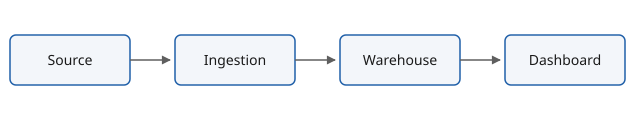

This is a placeholder. Every project page should answer the same few questions.

## Problem

What problem does this solve, and why does it matter?

## Architecture

Export diagrams from [Excalidraw](https://excalidraw.com) or [draw.io](https://www.drawio.com) as SVG/PNG and put them in this folder next to `index.md`.

## Tools

What you used, and why you chose it over the alternatives.

## Results

Screenshots, charts, numbers.

## What I learned

The honest version: what was hard, and what you would do differently.
