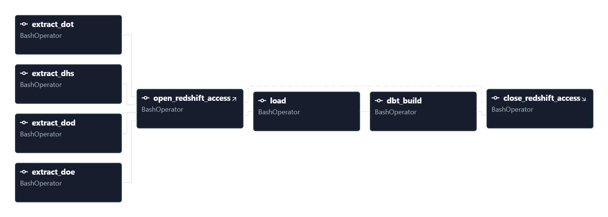
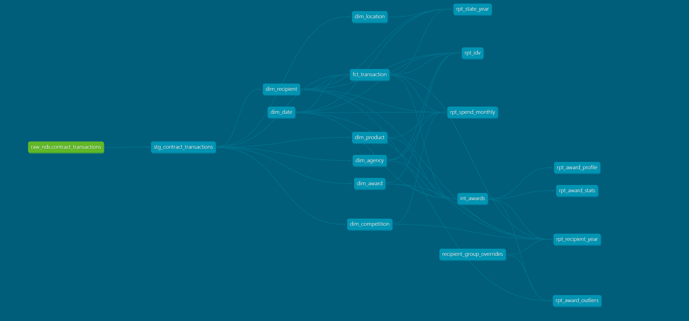

## Problem

Where does U.S. defense contract money actually go, and how has that changed? USASpending.gov publishes every federal contract transaction, but as bulk files with 297 columns, regenerated monthly, plus change files that update and delete earlier rows. That's hard to answer questions from directly.

I built a pipeline that loads defense contract spending from FY2017 on, about 41.8 million transactions, and models it so questions can be answered with tested SQL and a dashboard. Scope is OMB's National Defense budget function (050): the Department of Defense, plus the defense parts of Energy, Homeland Security, and Transportation.

## How it's built

- **Extract (Python):** downloads the bulk files, filters them to defense scope, and trims them to the 65 columns the schema needs. Raw zips and prestaged CSVs land in S3.
- **Load (Redshift Serverless):** `COPY` into all-varchar raw tables. Each file is tagged with its S3 key, so reruns are idempotent. After the first full load, only monthly change files are loaded.
- **Transform (dbt):** staging casts types, dedupes, and applies deletes. The marts are a star schema of seven dimensions and a transaction fact table. The recipient dimension is SCD Type 2, consolidating 459K inconsistent parent-company changes into 153K versions. 90+ data tests guard quality.
- **Orchestrate (Airflow in Docker):** runs monthly after USASpending publishes. Extracts run in parallel, then load and dbt, opening and closing Redshift network access around them.

## Findings

A six-page Power BI dashboard and written findings answer 20+ questions. A few:

- Contract obligations grew 55% from FY2017 to FY2025 ($340B to $526B), but only about 18% after inflation.
- Most money flows through existing contracts: 55% to 62% of each year's dollars fund awards already in place. Brand new contracts get only 9% to 14%.
- Mergers didn't speed up growth: four of five major defense mergers lost contract share after the deal.
- DoD puts about 15.5% of its annual contract dollars into September, nearly double an even month.

Full findings, caveats, and the query behind each answer are in the repo.
